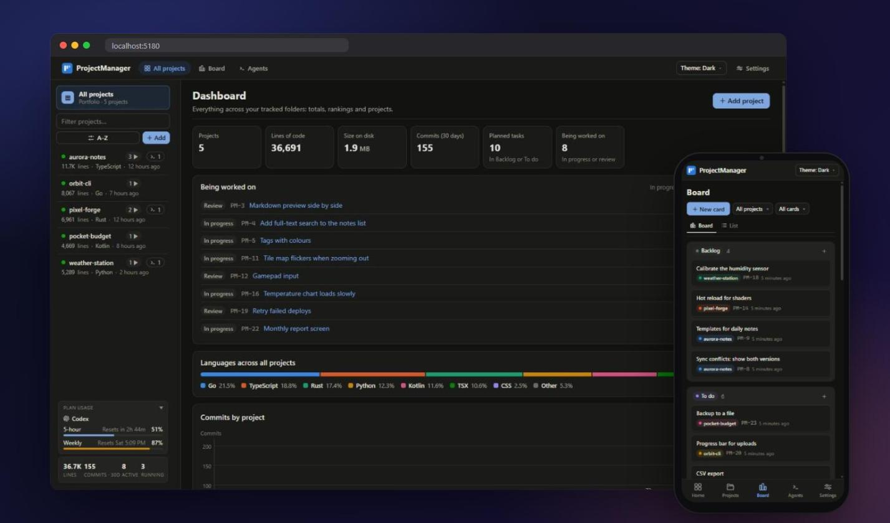
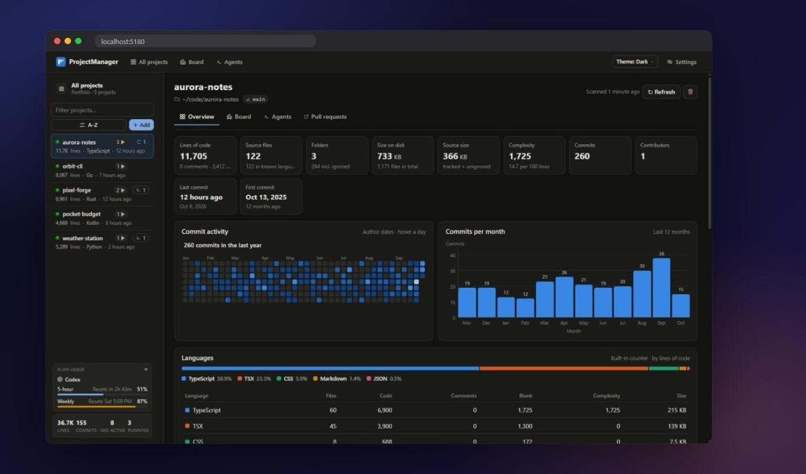
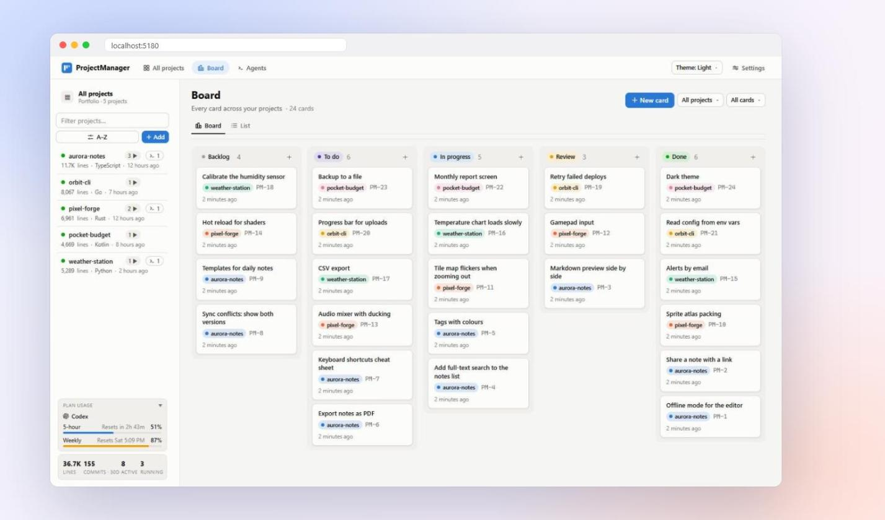
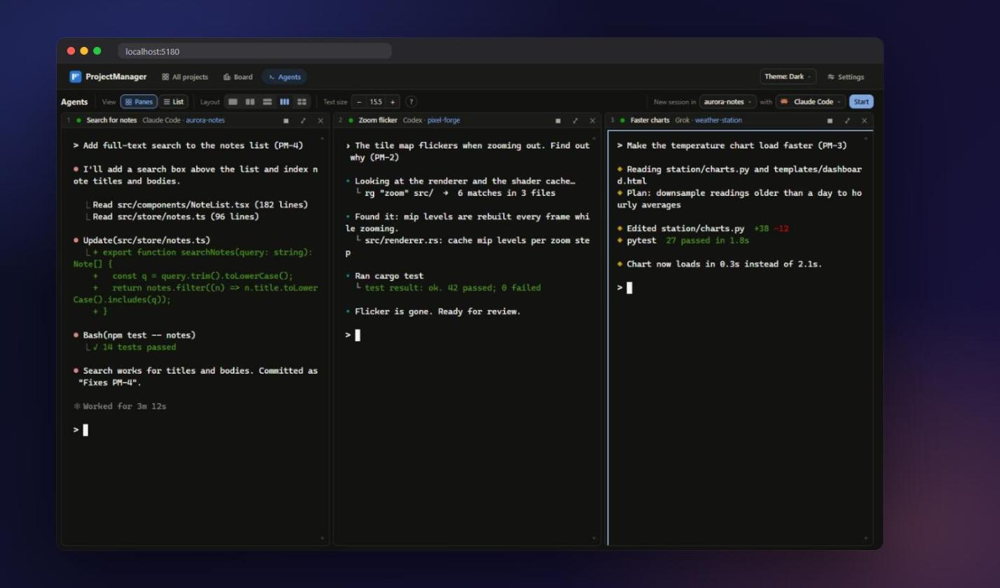
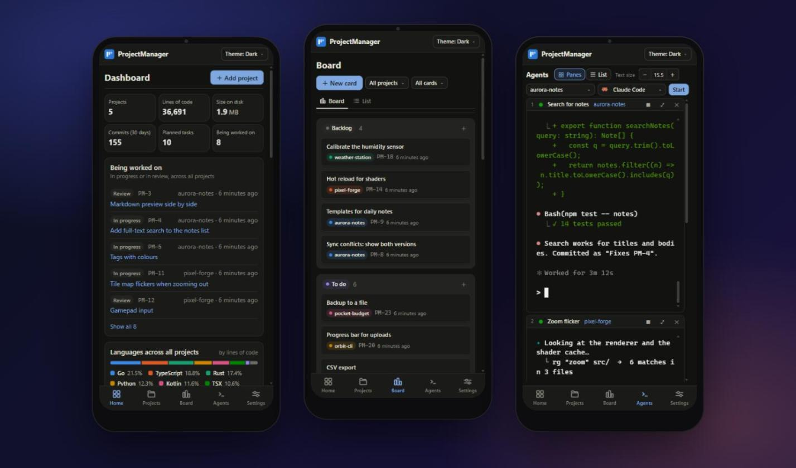
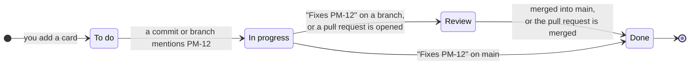

<div align="center">


# ProjectManager

**Persistent AI coding sessions. Every project. Any screen.**<br>
Organize Claude Code, Codex and other agent CLIs across your projects in one browser workspace.
Keep sessions running when you close a tab, resume conversations after restarts, and work from
your phone with compact controls and real terminal access. Your projects and session data stay
on your computer.

[](https://nodejs.org)
[](https://www.typescriptlang.org)
[](https://react.dev)
[](#-your-data-stays-yours)
[](#-quick-start)

[Quick start](#-quick-start) ·
[Features](#-what-you-get) ·
[How cards move](#-the-board-keeps-itself-up-to-date) ·
[AI agents](#-ai-agents-in-real-terminals) ·
[FAQ](#-faq)

<br>

<picture>
  <source media="(prefers-color-scheme: dark)" srcset="docs/screenshots/hero-dark.jpg">
  <source media="(prefers-color-scheme: light)" srcset="docs/screenshots/hero-light.jpg">
  
</picture>

<sub>Screenshots use demo projects. The hero image follows your GitHub theme.</sub>

</div>

---

## ✨ What you get

<table>
<tr>
<td width="50%" valign="top">

### 🔄 Sessions that survive restarts

Close the browser without stopping your agents. A separate session host keeps CLI processes
running across quick server restarts. Closing ProjectManager, even abruptly, ends them within
about 20 seconds; on the next start (or after a reboot) active sessions relaunch with their saved
conversation when the CLI supports resume; terminal history stays with the session.

</td>
<td width="50%" valign="top">

### 🤖 Multiple agents, multiple projects

Run **Claude Code, Codex, Grok, Antigravity and OpenCode** in the same workspace. Mix agent
harnesses across projects, name your sessions, and switch between a filtered list and up to
four terminal panes. See which sessions are working, idle, or waiting for your input.

</td>
</tr>
<tr>
<td width="50%" valign="top">

### 🗂️ Projects and tasks in context

Link sessions to board cards and hand work directly to an agent. Commits and pull requests move
cards through **Backlog → To do → In progress → Review → Done**. Code stats, languages, disk
usage and commit charts keep the bigger picture close to the work. The **Pull requests** tab
works like GitHub's own page: see checks, reviews and whether a PR can merge, then merge (merge
commit, squash or rebase, or auto-merge), update the branch, mark ready or draft, close or
reopen, and delete or restore the branch. With several accounts in `gh auth login`, it acts as
the one that owns the repo (shown as "Acting as …", and changeable per project).

</td>
<td width="50%" valign="top">

### 📱 Works on your phone too

Use the same workspace from your phone: compact session rows, collapsible tools and filters,
touch scrolling, fullscreen terminals and image uploads. Turn on LAN access and scan the host's
QR code to pair your browser once, then return to your sessions from anywhere on the same network.

</td>
</tr>
</table>

<details>
<summary><b>See the project page</b> &nbsp;·&nbsp; stats, heatmap and languages</summary>
<br>



</details>

<details open>
<summary><b>See the board</b> &nbsp;·&nbsp; every card across your projects</summary>
<br>



</details>

<details>
<summary><b>See the agents</b> &nbsp;·&nbsp; three AI agents working side by side</summary>
<br>



</details>

<details>
<summary><b>See it on a phone</b> &nbsp;·&nbsp; dashboard, board and agents</summary>
<br>



</details>

---

## 🚀 Quick start

You need **[Node.js 22.13 or newer](https://nodejs.org)** and **git**.

```bash
git clone https://github.com/meap158/ProjectManager.git
cd ProjectManager
npm install
npm run launch
```

Your browser opens on **http://localhost:5180**. Click **＋ Add**, pick a project folder, then
open **Agents → + New** to start a CLI session. Add more sessions across projects and agent
harnesses as needed; use **List** to find them or **Panes** to work side by side.

> [!TIP]
> On Windows you can double-click **`launch.bat`**. On macOS or Linux run **`./launch.sh`**.
> If port 5180 is busy, the launcher simply picks the next free one and tells you which.

<details>
<summary><b>Optional extras</b></summary>
<br>

| Install this                                                     | And you get                                                   |
| ---------------------------------------------------------------- | ------------------------------------------------------------- |
| An AI coding CLI: `claude`, `codex`, `grok`, `agy` or `opencode` | Persistent terminal sessions and agents that work on cards    |
| [GitHub CLI](https://cli.github.com) (`gh auth login`)           | Pull requests to review and merge, and cards that follow them |
| [scc](https://github.com/boyter/scc)                             | Faster, more precise line counts                              |

Missing an agent CLI? **Settings** can install it for you, using each vendor's official method.

</details>

<details>
<summary><b>Settings you can change</b> (<code>.env</code>)</summary>
<br>

Copy `.env.example` to `.env` and change what you need:

| Variable   | Default     | What it does                                              |
| ---------- | ----------- | --------------------------------------------------------- |
| `PORT`     | `5180`      | The port to try first (the next free one is used if busy) |
| `HOST`     | `127.0.0.1` | Where the server listens. Keep it local                   |
| `DATA_DIR` | `./data`    | Where your data (one SQLite file) is kept                 |
| `BROWSER`  | (unset)     | Set to `none` to stop the browser from opening            |
| `SCC`      | (unset)     | Set to `off` to ignore an installed `scc`                 |

</details>

---

## 🔄 The board keeps itself up to date

Every card has a key like **`PM-12`**. Just use it in your normal git work:



| You do this                                                         | The card moves to |
| ------------------------------------------------------------------- | ----------------- |
| Commit on any branch with `PM-12` in the message                    | **In progress**   |
| Create a branch named after it, like `pm-12-login`                  | **In progress**   |
| Commit `Fixes PM-12` on a branch that isn't merged yet              | **Review**        |
| Open a pull request that mentions `PM-12`                           | **Review**        |
| Commit `Fixes PM-12` on your main branch, or merge the pull request | **Done**          |

`closes`, `resolves` and `completes` work like `fixes`.

<details>
<summary><b>The fine print</b></summary>
<br>

- Commits are picked up within about 15 seconds, on every local branch and worktree.
- Pull requests are checked every 2 minutes for projects with a GitHub remote (needs `gh auth login`).
- Cards only ever move forward. Each commit or pull request counts once, so if you drag a card
  back, it stays where you put it.
- Commits made before a card existed never move it.

</details>

---

## 🤖 AI agents in real terminals

The **Agents** workspace brings your existing coding CLIs together. Start several sessions for
one project, or work across several projects and harnesses at once. Every row and pane keeps
the session's project and linked card visible, so you can switch tasks without losing context.

Session records, terminal logs and conversation identifiers are saved locally. Closing a tab
leaves the process running. The separate session host keeps CLI processes alive during quick
server restarts, and the app reconnects to them. Closing ProjectManager (or a crash) ends every
session's process within about 20 seconds, so no agent keeps running unseen. If the host is
unavailable, sessions run in the server and end with it. Active sessions relaunch when
ProjectManager starts again, using the CLI's saved conversation when available. Closing or
rebooting interrupts the current process; resuming the conversation does not preserve an
in-flight command.

| Agent       | Exact resume after a restart | Name syncs with `/rename` |
| ----------- | :--------------------------: | :-----------------------: |
| Claude Code |              ✅              |            ✅             |
| Codex       |              ✅              |            ✅             |
| Grok        |              ✅              |            ✅             |
| OpenCode    |              ✅              |             —             |
| Antigravity |              ✅              |             —             |

- **Hand over a card.** Open a card, choose an agent, and it starts in a terminal with the task
  already typed in. The card moves to **In progress**.
- **One-shot runs.** Or let the agent run on its own. When it finishes you see what changed
  ("3 files changed · 1 commit") and choose **Accept** or **Reject**.
- **Pick how much it may do:** Read-only, Edit files, or Full access. Set it once for every agent,
  or per agent.
- **Watch them side by side.** The **Agents** page shows 1 to 4 terminals at once.
  <kbd>Alt</kbd>+<kbd>1</kbd>…<kbd>4</kbd> jumps between panes, <kbd>Alt</kbd>+<kbd>Enter</kbd>
  makes one full size, and you can drag panes to swap them.
- **Pick up after a restart.** Hosted sessions keep running across server restarts; after a reboot,
  active sessions relaunch when ProjectManager starts again.
  **Start** reopens a stopped session using its saved conversation when the CLI can resume it.
  Terminal history stays available alongside the resumed session.
- **Keep many sessions organized.** Filter the list by project, agent, activity, or task name;
  rename sessions to distinguish several conversations with the same agent.
- **Working or waiting?** Each session shows whether the agent is busy or waiting for you.
- **Plan usage at a glance.** See how much of your 5-hour and weekly limits you've used, and
  when they reset (Claude Code and Codex).

<details>
<summary><b>Board tools for agents</b> (MCP)</summary>
<br>

Claude Code, Codex and OpenCode sessions started from ProjectManager get a small built-in tool
set, so the agent can read its card and keep it up to date: `get_card`, `update_status`,
`add_note`, `read_image` and `create_card`. An agent can only touch the card it was given. A
session started without a card can create one card for its own work. Every change is recorded in
the card's history.

Agents are also told to commit in small steps and mention their card (`Refs PM-12` while working,
`Fixes PM-12` when done), so the board follows their work.

Your CLI config files are never edited: the tools are passed to each process when it starts.

</details>

---

## 📱 Use it from your phone

1. Open **Settings → LAN access** and turn it on.
2. Scan the QR code shown on the host. It opens the address and fills in the current pairing code.
3. Tap **Sign in**. Use the same address and browser on future visits to stay signed in.

You can also open an address manually and type the **4-character code**. Prefer the computer's
`.local` address when your phone resolves it: it survives changes to the host's network IP.

Mobile controls prioritize the work: **+ New** opens session setup, **⋯** opens workspace tools,
and **Filters** reveals extra list filters. Session actions live under **⋯** in a terminal
header; maximize a pane to give the CLI more screen space.

<details>
<summary><b>How it stays safe</b></summary>
<br>

- LAN access is **off by default**. It uses the same port as the app (e.g. `192.168.1.20:5180`)
  but is a separate, guarded listener: the normal app still only listens on your own computer.
- A code works **once**, expires after **10 minutes**, and is thrown away after 5 wrong tries.
  Too many wrong tries from one device are blocked for a while.
- Each browser gets its own HttpOnly device cookie and appears in Settings, where you can sign it
  out. Tokens survive restarts; the cookie is renewed on page visits. Returning through links or
  a QR scan sends the cookie too. Clearing cookies, using private browsing, changing browsers or
  changing from an IP address to a hostname requires pairing that browser/address again.
- QR codes are generated locally and contain the same short-lived, single-use pairing code.
  The code is carried in the URL fragment and removed from the address after opening it.
- Only this computer's own network addresses are accepted, and a phone can't change the LAN
  settings.
- On Windows, allow Node.js on **Private** networks when asked.

Tip: add it to your home screen (Safari: Share → Add to Home Screen) to open it like an app.

In an agent's terminal, **swipe** to scroll back through the terminal, including the prompt and
footer in normal terminal mode. Touch updates are combined per display frame; full-screen
terminal apps keep their own scroll handling. To show an agent a picture, open **⋯** in the
terminal's header, tap the image icon and pick a photo or take one: it's sent to the computer and its path is pasted
in, so Claude Code attaches it as `[Image #1]`. On a computer you can also paste or drop an image
onto a terminal.

</details>

---

## 🔒 Your data stays yours

- Everything is stored in **one SQLite file** on your computer (`./data`). No account, no cloud,
  no tracking.
- ProjectManager **never changes files in your projects**. Only agents you start yourself do that.
  Removing a project from the list only stops tracking it.
- The server only listens on `127.0.0.1` and refuses requests from other websites.

---

## ❓ FAQ

<details>
<summary><b>Does it upload my code anywhere?</b></summary>
<br>
No. It reads your folders locally. The only outside connections are the ones you choose: the AI
agent CLIs you run (they talk to their own providers) and the GitHub CLI for pull requests.
</details>

<details>
<summary><b>Do I need an AI agent to use it?</b></summary>
<br>
No. Stats, the activity heatmaps, the dashboard and the self-updating board all work without one.
</details>

<details>
<summary><b>Can I use Claude Code and Codex together?</b></summary>
<br>
Yes. Each session runs its own CLI in its project's folder. Mix supported agents, keep several
conversations per project, and use List or Panes to move between them. ProjectManager uses your
installed CLIs and their existing provider authentication.
</details>

<details>
<summary><b>Will many agents at once overload my computer?</b></summary>
<br>
Settings → CPU budget caps how many CPU threads all agents may use together, including the
builds and tests they start (three quarters by default), and runs them at below-normal priority
so the rest of your computer stays responsive. Card runs also share a machine-wide limit: up to a
quarter of your CPU threads (at most 4) run at once, and the rest wait as queued and start on
their own when one finishes. Project scans run two at a time. Closing ProjectManager ends every
agent it started.
</details>

<details>
<summary><b>What happens if I close the browser or restart my computer?</b></summary>
<br>
Closing the browser leaves sessions running. The separate session host also keeps CLI processes
running across quick server restarts. Closing ProjectManager (even by closing its window or
ending it in Task Manager) or rebooting ends them, then active sessions relaunch when
ProjectManager starts again. Saved conversation identifiers let supported CLIs resume their
conversation; terminal history is retained locally.
</details>

<details>
<summary><b>Which languages does it count?</b></summary>
<br>
Dozens, from TypeScript, Python, Go and Rust to Kotlin, C#, shaders and config files. Generated
folders like <code>node_modules</code> and build output are left out of the code stats but still
show up in the size on disk.
</details>

<details>
<summary><b>Can it run on a server for my team?</b></summary>
<br>
It's built for one person on one computer. It can read your folders and run agents, so don't put
it on the internet. LAN access is for your own devices at home.
</details>

---

## 🛠️ For developers

| Command          | What it does                                                   |
| ---------------- | -------------------------------------------------------------- |
| `npm run launch` | Start with hot reload (same as `npm run dev`)                  |
| `npm run check`  | Typecheck, lint, format check and all the tests                |
| `npm run build`  | Build for production into `dist/` (sets production `NODE_ENV`) |
| `npm start`      | Run the production build                                       |

Built with **Node.js** (built-in `node:sqlite`, so no database to set up), **Hono**, **React 19**,
**Vite**, **xterm.js** and **node-pty** (optional, for terminals).

Contributors and AI agents: start with [CLAUDE.md](CLAUDE.md) (how we work),
[DESIGN.md](DESIGN.md) (how it looks) and [AGENT_HANDOVER.md](AGENT_HANDOVER.md) (where things
stand).

---

## 🙏 Credits

- Animated components by **[Rare UI](https://rareui.com)** (MIT + Commons Clause; attribution
  required).
- Agent marks: Claude Code and OpenCode from [Simple Icons](https://simpleicons.org) (CC0); Codex
  (the OpenAI mark), Grok and Antigravity from
  [LobeHub Icons](https://github.com/lobehub/lobe-icons) (MIT, Copyright (c) 2023 LobeHub). They
  only identify each tool; the trademarks belong to their owners.

<div align="center">
<br>
<sub>Made for people running several coding agents across several projects. ⭐ Star it if it helps you keep your work together.</sub>
</div>

### Linking board cards to GitHub issues

In a card editor, set **GitHub issue** to its full `https://github.com/owner/repo/issues/123`
URL. The link is saved separately from the PM card key; issue #123 is never assumed to be PM-123.
New default agent prompts include both identities and instructions for referencing them.

On a project refresh, linked issue references in commits move cards to In progress.
Closing commits on feature branches move them to Review; closing commits on the default
branch move them to Done. An open pull request moves linked work to Review. A merged PR
completes linked issue work only when GitHub reports that issue as a closing reference.
A non-closing mention stays in Review. Closed, unmerged PRs do not complete cards.
Short `#123` references resolve only against the project's origin repository; full issue
URLs and `owner/repo#123` references are explicit. Existing PM references continue working.

Use `Closes https://github.com/owner/repo/issues/123` in a PR body when it fully resolves the
issue. GitHub closes linked issues when the PR merges into the default branch:
[GitHub linking documentation](https://docs.github.com/en/issues/tracking-your-work-with-issues/using-issues/linking-a-pull-request-to-an-issue).
GitHub issue state is Open/Closed, whereas a Project's status field holds workflow columns.
This integration reads commit/PR evidence into the local board; dragging local cards does
not yet write GitHub Project status or request reviewers. Those remote actions need a
separate opt-in synchronization policy with durable retries and visible failures.
