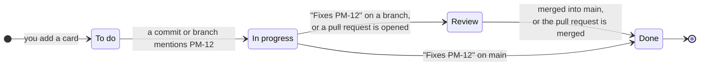

<div align="center">


# ProjectManager

**A local-first workspace for running Claude Code, Codex, Grok, Antigravity and OpenCode across all your projects, with a self-updating Kanban board.**<br>
Persistent AI coding agent sessions. Every project. Any screen, including your phone.
Your projects and session data stay on your computer.

[](https://nodejs.org)
[](https://www.typescriptlang.org)
[](https://react.dev)
[](#-your-data-stays-yours)
[](#-quick-start)

[Quick start](#-quick-start) ·
[Features](#-what-you-get) ·
[Board](#-the-board-keeps-itself-up-to-date) ·
[AI agents](#-ai-agents-in-real-terminals) ·
[Phone](#-use-it-from-your-phone) ·
[Roadmap](#-roadmap) ·
[FAQ](#-faq)

<br>

<picture>
  <source media="(prefers-color-scheme: dark)" srcset="docs/screenshots/hero-dark.jpg">
  <source media="(prefers-color-scheme: light)" srcset="docs/screenshots/hero-light.jpg">
  
</picture>

<sub>Screenshots use demo projects. The hero image follows your GitHub theme.</sub>

</div>

**ProjectManager** is an open-source, self-hosted AI coding agent manager and project dashboard.
Add your project folders, start agent CLI sessions in real terminals, link them to board cards, and
watch commits and pull requests move the cards for you. No account, no cloud, no tracking.

---

## ✨ What you get

<table>
<tr>
<td width="50%" valign="top">

### 🔄 Sessions that survive restarts

Close the browser without stopping your agents. A separate session host keeps CLI processes
running across quick server restarts, and active sessions relaunch with their saved conversation
when the CLI supports resume. Terminal history stays with the session.

</td>
<td width="50%" valign="top">

### 🤖 Multiple agents, multiple projects

Run **Claude Code, Codex, Grok, Antigravity and OpenCode** side by side. Name sessions, filter
the list, or watch up to four terminal panes. See which sessions are working, idle or waiting
for you, and switch saved Codex and Claude accounts under **Settings > Agent CLIs**.

</td>
</tr>
<tr>
<td width="50%" valign="top">

### 🗂️ Projects and tasks in context

Link sessions to board cards and hand work to an agent. Commits and pull requests move cards
through **Backlog → To do → In progress → Review → Done**. Code stats, languages, disk usage and
commit heatmaps sit beside the work. The **Pull requests** tab shows checks, reviews and
mergeability, and merges, updates or closes PRs as the repo owner's `gh` account. The **Files**
tab browses the project like VS Code's explorer and previews Markdown, HTML, images and code
(previews can't run scripts). Right-click a file for open, reveal in the file manager, copy path and
rename (on the computer running ProjectManager only).

</td>
<td width="50%" valign="top">

### 📱 Works on your phone too

Compact session rows, collapsible filters, touch scrolling, fullscreen terminals, image uploads
and a mobile chat view. Turn on LAN access and scan a QR code to pair your phone once.

</td>
</tr>
</table>

<details>
<summary><b>See the project page</b> &nbsp;·&nbsp; stats, heatmap and languages</summary>
<br>


</details>

<details open>
<summary><b>See the board</b> &nbsp;·&nbsp; every card across your projects</summary>
<br>


</details>

<details>
<summary><b>See the agents</b> &nbsp;·&nbsp; three AI agents working side by side</summary>
<br>


</details>

<details>
<summary><b>See it on a phone</b> &nbsp;·&nbsp; dashboard, board and agents</summary>
<br>


</details>

### Recent quality-of-life updates

- **Account switching:** saved Codex and Claude logins, optional Antigravity accounts, live usage
  and reset times, and automatic Codex rotation at usage limits.
- **Batch CLI choices:** answer matching attention menus across many sessions at once, with
  queued and failed input reported.
- **Keyboard shortcuts:** act on the selected session without leaving the keyboard, assignable in
  Settings.
- **Orchestrators:** a chat that follows up on tasks and moves cards across all your projects.
- **Remote access (opt-in):** reach your workspace through your own Cloudflare Tunnel with
  Cloudflare Access, an email allowlist and an authenticator code.
- **Searchable dropdowns, grouped Settings tabs, chat view for OpenCode and Grok** and a more
  stable launcher that restarts the server after an unexpected exit.

---

## 🚀 Quick start

You need **[Node.js 22.13 or newer](https://nodejs.org)** and **git**.

```bash
git clone https://github.com/meap158/ProjectManager.git
cd ProjectManager
npm install
npm run launch
```

Your browser opens on **http://localhost:5180**. Click **＋ Add**, pick a project folder, then
open **Agents → + New** to start a CLI session.

> [!TIP]
> On Windows you can double-click **`launch.bat`**. On macOS or Linux run **`./launch.sh`**.
> If port 5180 is busy, the launcher picks the next free one and tells you which.

<details>
<summary><b>Optional extras</b></summary>
<br>

| Install this                                                     | And you get                                                   |
| ---------------------------------------------------------------- | ------------------------------------------------------------- |
| An AI coding CLI: `claude`, `codex`, `grok`, `agy` or `opencode` | Persistent terminal sessions and agents that work on cards    |
| [GitHub CLI](https://cli.github.com) (`gh auth login`)           | Pull requests to review and merge, and cards that follow them |
| [scc](https://github.com/boyter/scc)                             | Faster, more precise line counts                              |

Missing an agent CLI? **Settings** can install it for you, using each vendor's official method.

</details>

<details>
<summary><b>Settings you can change</b> (<code>.env</code>)</summary>
<br>

Copy `.env.example` to `.env` and change what you need:

| Variable   | Default     | What it does                                              |
| ---------- | ----------- | --------------------------------------------------------- |
| `PORT`     | `5180`      | The port to try first (the next free one is used if busy) |
| `HOST`     | `127.0.0.1` | Where the server listens. Keep it local                   |
| `DATA_DIR` | `./data`    | Where your data (one SQLite file) is kept                 |
| `BROWSER`  | (unset)     | Set to `none` to stop the browser from opening            |
| `SCC`      | (unset)     | Set to `off` to ignore an installed `scc`                 |

</details>

The launcher restarts the server after an unexpected exit (at most five times in five minutes).
Ctrl+C still stops it. Its window is titled `ProjectManager - Server` and, once running, shows the port it
chose (for example `ProjectManager - Server :5181`), so several windows are easy to tell apart. Crash output goes to `data/server-output.log` and `data/server-crashes.log`.

---

## 🔄 The board keeps itself up to date

Every card has a key like **`PM-12`**. Just use it in your normal git work:



| You do this                                                         | The card moves to |
| ------------------------------------------------------------------- | ----------------- |
| Commit on any branch with `PM-12` in the message                    | **In progress**   |
| Create a branch named after it, like `pm-12-login`                  | **In progress**   |
| Commit `Fixes PM-12` on a branch that isn't merged yet              | **Review**        |
| Open a pull request that mentions `PM-12`                           | **Review**        |
| Commit `Fixes PM-12` on your main branch, or merge the pull request | **Done**          |

`closes`, `resolves` and `completes` work like `fixes`.

<details>
<summary><b>The fine print</b></summary>
<br>

- Commits are picked up within about 15 seconds, on every local branch and worktree.
- Pull requests are checked every 2 minutes for projects with a GitHub remote (needs `gh auth login`).
- Cards only ever move forward. Each commit or pull request counts once, so if you drag a card
  back, it stays where you put it.
- Commits made before a card existed never move it.

</details>

<details>
<summary><b>Linking cards to GitHub issues</b></summary>
<br>

In a card editor, set **GitHub issue** to its full `https://github.com/owner/repo/issues/123`
URL. The link is saved separately from the PM key; issue #123 is never assumed to be PM-123.

- A commit referencing the issue moves the card to **In progress**.
- A closing commit on a feature branch moves it to **Review**; on the default branch, to **Done**.
- An open pull request moves linked work to **Review**. A merged PR completes it only when GitHub
  reports the issue as a closing reference. Closed, unmerged PRs never complete cards.
- Short `#123` references resolve only against the project's origin repository; full URLs and
  `owner/repo#123` are explicit.

Use `Closes https://github.com/owner/repo/issues/123` in a PR body to close the issue on merge
([GitHub docs](https://docs.github.com/en/issues/tracking-your-work-with-issues/using-issues/linking-a-pull-request-to-an-issue)).
This reads commit and PR evidence into the local board; dragging a local card does not write
GitHub Project status.

</details>

---

## 🤖 AI agents in real terminals

The **Agents** workspace brings your existing coding CLIs together. Every row and pane shows the
session's project and linked card, so you can switch tasks without losing context.

| Agent       | Exact resume after a restart | Name syncs with `/rename` |
| ----------- | :--------------------------: | :-----------------------: |
| Claude Code |              ✅              |            ✅             |
| Codex       |              ✅              |            ✅             |
| Grok        |              ✅              |            ✅             |
| OpenCode    |              ✅              |             —             |
| Antigravity |              ✅              |             —             |

- **Hand over a card.** Choose an agent and it starts in a terminal with the task typed in. The
  card moves to **In progress**.
- **One-shot runs.** Let the agent run on its own; when it finishes you see what changed and
  choose **Accept** or **Reject**.
- **Pick how much it may do:** Read-only, Edit files, or Full access, globally or per agent.
- **Watch them side by side.** 1 to 4 terminals at once. <kbd>Alt</kbd>+<kbd>1</kbd>…<kbd>4</kbd>
  jumps between panes, <kbd>Alt</kbd>+<kbd>Enter</kbd> maximizes one, and you can drag panes to swap them.
- **Stay organized.** Filter by project, agent, activity or task name, and rename sessions.
- **Plan usage at a glance.** See your 5-hour and weekly limits and when they reset (Claude Code
  and Codex).
- **Batch CLI choices.** Apply detected attention-menu choices across sessions.

Closing ProjectManager (or a crash) ends every session's process within about 20 seconds, so no
agent keeps running unseen. Resuming a conversation does not preserve an in-flight command.

<details>
<summary><b>Board tools for agents</b> (MCP)</summary>
<br>

Claude Code, Codex and OpenCode sessions started from ProjectManager get a small built-in tool
set so the agent can read its card and keep it up to date: `get_card`, `update_status`,
`add_note`, `read_image` and `create_card`. An agent can only touch the card it was given. Every
change is recorded in the card's history.

Agents are told to commit in small steps and mention their card (`Refs PM-12` while working,
`Fixes PM-12` when done), so the board follows their work. Your CLI config files are never
edited: the tools are passed to each process when it starts.

</details>

<details>
<summary><b>Keyboard shortcuts</b></summary>
<br>

In the Agents list, select a session and act on it from the keyboard, even while its terminal
has focus: <kbd>Ctrl</kbd>+<kbd>↓</kbd>/<kbd>↑</kbd> moves the selection, and
<kbd>Alt</kbd>+<kbd>Shift</kbd> with <kbd>P</kbd> shows it in a pane, <kbd>C</kbd> continues it,
<kbd>R</kbd> restarts it, <kbd>S</kbd> stops or starts it and <kbd>D</kbd> deletes it (after
asking). Change any of them under **Settings > Keyboard shortcuts**.

</details>

---

## 📱 Use it from your phone

1. Open **Settings → LAN access** and turn it on.
2. Scan the QR code shown on the host. It opens the address and fills in the pairing code.
3. Tap **Sign in**. Use the same address and browser on future visits to stay signed in.

You can also type the **4-character code** manually. Prefer the computer's `.local` address when
your phone resolves it: it survives changes to the host's network IP. Mobile chat is available
for Claude Code, Codex, OpenCode and Grok sessions; CLI view shows the original screen.

<details>
<summary><b>How it stays safe</b></summary>
<br>

- LAN access is **off by default**. It is a separate, guarded listener on the app's port; the
  normal app still only listens on your own computer.
- A code works **once**, expires after **10 minutes**, and is thrown away after 5 wrong tries.
- Each browser gets its own HttpOnly device cookie and appears in Settings, where you can sign it
  out. Clearing cookies, private browsing or switching browser or address means pairing again.
- Only this computer's own network addresses are accepted, and a phone can't change LAN settings.
- On Windows, allow Node.js on **Private** networks when asked.

Add it to your home screen (Safari: Share → Add to Home Screen) to open it like an app. Phones
get a small production build of the app, made in the background the first time one connects.

</details>

For access away from home, the opt-in Cloudflare Tunnel mode puts Cloudflare Access (MFA), an
email allowlist and an authenticator code in front of it: see
[docs/REMOTE-ACCESS.md](docs/REMOTE-ACCESS.md).

---

## 🔒 Your data stays yours

- Everything is stored in **one SQLite file** on your computer (`./data`). No account, no cloud,
  no tracking.
- ProjectManager **never changes files in your projects**. Only agents you start yourself do that.
  Removing a project from the list only stops tracking it.
- The server only listens on `127.0.0.1` and refuses requests from other websites.

---

## 🗺️ Roadmap

**Next**

- [x] Project file tree with a VS Code-style explorer and Markdown/HTML preview (PM-252)
- [x] Files context menu: open, open in the system app, reveal, copy path, rename in place (PM-259)
- [x] Inbox: a top-bar bell lists every session that needs a decision, failed, hit a usage limit or finished its reply, with the question or reply on each row, answerable in place (PM-261)
- [x] Built-in browser: a **Preview** page lists running `localhost` apps (front ends first) beside a small browser; apps run on their own origin with live reload, and over the LAN or remotely it is a read-only view (PM-253)
- [ ] More agent options, such as OpenCode with other models and Cline (PM-212)
- [ ] Ideas from terminal agent managers: agent state, inbox, hooks (PM-211)

**Recently shipped**

- [x] Account switching with live usage for Codex, Claude and Antigravity
- [x] Orchestrator chat across all projects
- [x] Remote access through Cloudflare Tunnel
- [x] Pull requests tab with merge, update and branch actions
- [x] Mobile chat view and phone-friendly Agents workspace

The fuller plan, with scope, phases and risks, is in [ROADMAP.md](ROADMAP.md).

Have an idea? [Open an issue](https://github.com/meap158/ProjectManager/issues).

---

## ❓ FAQ

<details>
<summary><b>Does it upload my code anywhere?</b></summary>
<br>
No. It reads your folders locally. The only outside connections are the ones you choose: the AI
agent CLIs you run (they talk to their own providers) and the GitHub CLI for pull requests.
</details>

<details>
<summary><b>Do I need an AI agent to use it?</b></summary>
<br>
No. Stats, the activity heatmaps, the dashboard and the self-updating board all work without one.
</details>

<details>
<summary><b>Can I use Claude Code and Codex together?</b></summary>
<br>
Yes. Each session runs its own CLI in its project's folder, using your installed CLIs and their
existing authentication. Mix agents and keep several conversations per project.
</details>

<details>
<summary><b>Will many agents at once overload my computer?</b></summary>
<br>
Settings → CPU budget caps how many CPU threads all agents may use together (three quarters by
default) and runs them at below-normal priority. Card runs also share a machine-wide limit of up
to a quarter of your CPU threads (at most 4); the rest queue and start on their own.
</details>

<details>
<summary><b>What happens if I close the browser or restart my computer?</b></summary>
<br>
Closing the browser leaves sessions running. Closing ProjectManager or rebooting ends them, then
active sessions relaunch when ProjectManager starts again, resuming the saved conversation where
the CLI supports it. Terminal history is retained locally.
</details>

<details>
<summary><b>Which languages does it count?</b></summary>
<br>
Dozens, from TypeScript, Python, Go and Rust to Kotlin, C#, shaders and config files. Generated
folders like <code>node_modules</code> and build output are left out of code stats but still show
up in size on disk.
</details>

<details>
<summary><b>Can it run on a server for my team?</b></summary>
<br>
It's built for one person on one computer. It can read your folders and run agents, so don't put
it on the internet directly. Use LAN access for your own devices, or the opt-in Cloudflare Tunnel
mode described above.
</details>

---

## 🛠️ For developers

| Command          | What it does                                                   |
| ---------------- | -------------------------------------------------------------- |
| `npm run launch` | Start with hot reload (same as `npm run dev`)                  |
| `npm run check`  | Typecheck, lint, format check and all the tests                |
| `npm run build`  | Build for production into `dist/` (sets production `NODE_ENV`) |
| `npm start`      | Run the production build                                       |

Built with **Node.js** (built-in `node:sqlite`, so no database to set up), **Hono**, **React 19**,
**Vite**, **xterm.js** and **node-pty** (optional, for terminals).

Contributors and AI agents: start with [AGENTS.md](AGENTS.md) (how we work),
[DESIGN.md](DESIGN.md) (how it looks) and [AGENT_HANDOVER.md](AGENT_HANDOVER.md) (where things
stand, local only).

---

## 🙏 Credits

- Animated components by **[Rare UI](https://rareui.com)** (MIT + Commons Clause; attribution
  required).
- Agent marks: Claude Code and OpenCode from [Simple Icons](https://simpleicons.org) (CC0); Codex
  (the OpenAI mark), Grok and Antigravity from
  [LobeHub Icons](https://github.com/lobehub/lobe-icons) (MIT, Copyright (c) 2023 LobeHub). They
  only identify each tool; the trademarks belong to their owners.

<div align="center">
<br>
<sub>Made for people running several coding agents across several projects. ⭐ Star it if it helps you keep your work together.</sub>
</div>

<!-- Topics: ai-coding-agents, claude-code, codex, kanban, project-management, local-first, terminal, mcp, developer-tools -->

Codex automatic account switching waits for safe idle prompts so grace work can finish. Accounts
are ranked by remaining 5-hour quota, weekly quota, then saved order, with fresh positive quota
required in every reported window. See [the account audit](docs/ACCOUNT-SWITCHER-AUDIT.md).
