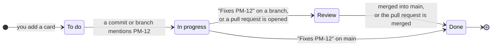

<div align="center">


# ProjectManager

**One home for every code project on your computer.**<br>
See what each project is made of, plan the work on a board, and let AI coding agents do the tasks,
all in your browser, all on your machine.

[](https://nodejs.org)
[](https://www.typescriptlang.org)
[](https://react.dev)
[](#-your-data-stays-yours)
[](#-quick-start)

[Quick start](#-quick-start) ·
[Features](#-what-you-get) ·
[How cards move](#-the-board-keeps-itself-up-to-date) ·
[AI agents](#-ai-agents-in-real-terminals) ·
[FAQ](#-faq)

<br>

<picture>
  <source media="(prefers-color-scheme: dark)" srcset="docs/screenshots/hero-dark.jpg">
  <source media="(prefers-color-scheme: light)" srcset="docs/screenshots/hero-light.jpg">
  
</picture>

<sub>Screenshots use demo projects. The hero image follows your GitHub theme.</sub>

</div>

---

## ✨ What you get

<table>
<tr>
<td width="50%" valign="top">

### 📊 Every project at a glance

Add your project folders once. ProjectManager counts the lines of code, finds the languages,
measures the size on disk and reads the git history. You get a GitHub-style activity heatmap for
each project and a dashboard that ranks all of them.

</td>
<td width="50%" valign="top">

### 🗂️ A board that updates itself

Each project gets a board: **Backlog → To do → In progress → Review → Done**. Mention a card in a
commit, open a pull request for it or merge it, and the card moves on its own. No clicking, and no
AI needed for that.

</td>
</tr>
<tr>
<td width="50%" valign="top">

### 🤖 AI agents in real terminals

Hand a card to **Claude Code, Codex, Grok, Antigravity or OpenCode**. Each one runs in a real
terminal inside the app. Watch up to four side by side, and pick up exactly where you left off
after a restart.

</td>
<td width="50%" valign="top">

### 📱 Works on your phone too

A phone layout with a bottom tab bar. Turn on LAN access, type a 4-letter code on your phone, and
check on your agents from the couch.

</td>
</tr>
</table>

<details>
<summary><b>See the project page</b> &nbsp;·&nbsp; stats, heatmap and languages</summary>
<br>


</details>

<details open>
<summary><b>See the board</b> &nbsp;·&nbsp; every card across your projects</summary>
<br>


</details>

<details>
<summary><b>See the agents</b> &nbsp;·&nbsp; three AI agents working side by side</summary>
<br>


</details>

<details>
<summary><b>See it on a phone</b> &nbsp;·&nbsp; dashboard, board and agents</summary>
<br>


</details>

---

## 🚀 Quick start

You need **[Node.js 22.13 or newer](https://nodejs.org)** and **git**.

```bash
git clone https://github.com/meap158/ProjectManager.git
cd ProjectManager
npm install
npm run launch
```

Your browser opens on **http://localhost:5180**. Click **＋ Add**, pick a project folder, and
you're done.

> [!TIP]
> On Windows you can double-click **`launch.bat`**. On macOS or Linux run **`./launch.sh`**.
> If port 5180 is busy, the launcher simply picks the next free one and tells you which.

<details>
<summary><b>Optional extras</b></summary>
<br>

| Install this                                                     | And you get                                               |
| ---------------------------------------------------------------- | --------------------------------------------------------- |
| An AI coding CLI: `claude`, `codex`, `grok`, `agy` or `opencode` | Agents that work on your cards                            |
| [GitHub CLI](https://cli.github.com) (`gh auth login`)           | Pull requests on each project, and cards that follow them |
| [scc](https://github.com/boyter/scc)                             | Faster, more precise line counts                          |

Missing an agent CLI? **Settings** can install it for you, using each vendor's official method.

</details>

<details>
<summary><b>Settings you can change</b> (<code>.env</code>)</summary>
<br>

Copy `.env.example` to `.env` and change what you need:

| Variable   | Default     | What it does                                              |
| ---------- | ----------- | --------------------------------------------------------- |
| `PORT`     | `5180`      | The port to try first (the next free one is used if busy) |
| `HOST`     | `127.0.0.1` | Where the server listens. Keep it local                   |
| `DATA_DIR` | `./data`    | Where your data (one SQLite file) is kept                 |
| `BROWSER`  | (unset)     | Set to `none` to stop the browser from opening            |
| `SCC`      | (unset)     | Set to `off` to ignore an installed `scc`                 |

</details>

---

## 🔄 The board keeps itself up to date

Every card has a key like **`PM-12`**. Just use it in your normal git work:



| You do this                                                         | The card moves to |
| ------------------------------------------------------------------- | ----------------- |
| Commit on any branch with `PM-12` in the message                    | **In progress**   |
| Create a branch named after it, like `pm-12-login`                  | **In progress**   |
| Commit `Fixes PM-12` on a branch that isn't merged yet              | **Review**        |
| Open a pull request that mentions `PM-12`                           | **Review**        |
| Commit `Fixes PM-12` on your main branch, or merge the pull request | **Done**          |

`closes`, `resolves` and `completes` work like `fixes`.

<details>
<summary><b>The fine print</b></summary>
<br>

- Commits are picked up within about 15 seconds, on every local branch and worktree.
- Pull requests are checked every 2 minutes for projects with a GitHub remote (needs `gh auth login`).
- Cards only ever move forward. Each commit or pull request counts once, so if you drag a card
  back, it stays where you put it.
- Commits made before a card existed never move it.

</details>

---

## 🤖 AI agents in real terminals

| Agent       | Exact resume after a restart | Name syncs with `/rename` |
| ----------- | :--------------------------: | :-----------------------: |
| Claude Code |              ✅              |            ✅             |
| Codex       |              ✅              |            ✅             |
| Grok        |              ✅              |            ✅             |
| OpenCode    |              ✅              |             —             |
| Antigravity |              ✅              |             —             |

- **Hand over a card.** Open a card, choose an agent, and it starts in a terminal with the task
  already typed in. The card moves to **In progress**.
- **One-shot runs.** Or let the agent run on its own. When it finishes you see what changed
  ("3 files changed · 1 commit") and choose **Accept** or **Reject**.
- **Pick how much it may do:** Read-only, Edit files, or Full access. Set it once for every agent,
  or per agent.
- **Watch them side by side.** The **Agents** page shows 1 to 4 terminals at once.
  <kbd>Alt</kbd>+<kbd>1</kbd>…<kbd>4</kbd> jumps between panes, <kbd>Alt</kbd>+<kbd>Enter</kbd>
  makes one full size, and you can drag panes to swap them.
- **Nothing is lost.** Sessions keep running when you close the tab, come back after a reboot,
  and **Start** reopens the exact conversation each agent was in.
- **Working or waiting?** Each session shows whether the agent is busy or waiting for you.
- **Plan usage at a glance.** See how much of your 5-hour and weekly limits you've used, and
  when they reset (Claude Code and Codex).

<details>
<summary><b>Board tools for agents</b> (MCP)</summary>
<br>

Claude Code, Codex and OpenCode sessions started from ProjectManager get a small built-in tool
set, so the agent can read its card and keep it up to date: `get_card`, `update_status`,
`add_note`, `read_image` and `create_card`. An agent can only touch the card it was given. A
session started without a card can create one card for its own work. Every change is recorded in
the card's history.

Agents are also told to commit in small steps and mention their card (`Refs PM-12` while working,
`Fixes PM-12` when done), so the board follows their work.

Your CLI config files are never edited: the tools are passed to each process when it starts.

</details>

---

## 📱 Use it from your phone

1. Open **Settings → LAN access** and turn it on.
2. On your phone, open the address shown there.
3. Type the **4-letter code** from your computer. That's it.

<details>
<summary><b>How it stays safe</b></summary>
<br>

- LAN access is **off by default** and runs on its own port. The normal app only listens on your
  own computer.
- A code works **once**, expires after **10 minutes**, and is thrown away after 5 wrong tries.
  Too many wrong tries from one device are blocked for a while.
- Each signed-in device gets its own secure cookie and appears in Settings, where you can sign it
  out. Devices stay signed in across restarts.
- Only this computer's own network addresses are accepted, and a phone can't change the LAN
  settings.
- On Windows, allow Node.js on **Private** networks when asked.

Tip: add it to your home screen (Safari: Share → Add to Home Screen) to open it like an app.

</details>

---

## 🔒 Your data stays yours

- Everything is stored in **one SQLite file** on your computer (`./data`). No account, no cloud,
  no tracking.
- ProjectManager **never changes files in your projects**. Only agents you start yourself do that.
  Removing a project from the list only stops tracking it.
- The server only listens on `127.0.0.1` and refuses requests from other websites.

---

## ❓ FAQ

<details>
<summary><b>Does it upload my code anywhere?</b></summary>
<br>
No. It reads your folders locally. The only outside connections are the ones you choose: the AI
agent CLIs you run (they talk to their own providers) and the GitHub CLI for pull requests.
</details>

<details>
<summary><b>Do I need an AI agent to use it?</b></summary>
<br>
No. Stats, the activity heatmaps, the dashboard and the self-updating board all work without one.
</details>

<details>
<summary><b>Which languages does it count?</b></summary>
<br>
Dozens, from TypeScript, Python, Go and Rust to Kotlin, C#, shaders and config files. Generated
folders like <code>node_modules</code> and build output are left out of the code stats but still
show up in the size on disk.
</details>

<details>
<summary><b>Can it run on a server for my team?</b></summary>
<br>
It's built for one person on one computer. It can read your folders and run agents, so don't put
it on the internet. LAN access is for your own devices at home.
</details>

---

## 🛠️ For developers

| Command          | What it does                                    |
| ---------------- | ----------------------------------------------- |
| `npm run launch` | Start with hot reload (same as `npm run dev`)   |
| `npm run check`  | Typecheck, lint, format check and all the tests |
| `npm run build`  | Build for production into `dist/`               |
| `npm start`      | Run the production build                        |

Built with **Node.js** (built-in `node:sqlite`, so no database to set up), **Hono**, **React 19**,
**Vite**, **xterm.js** and **node-pty** (optional, for terminals).

Contributors and AI agents: start with [CLAUDE.md](CLAUDE.md) (how we work),
[DESIGN.md](DESIGN.md) (how it looks) and [AGENT_HANDOVER.md](AGENT_HANDOVER.md) (where things
stand).

---

## 🙏 Credits

- Animated components by **[Rare UI](https://rareui.com)** (MIT + Commons Clause; attribution
  required).
- Agent marks: Claude Code and OpenCode from [Simple Icons](https://simpleicons.org) (CC0); Codex
  (the OpenAI mark), Grok and Antigravity from
  [LobeHub Icons](https://github.com/lobehub/lobe-icons) (MIT, Copyright (c) 2023 LobeHub). They
  only identify each tool; the trademarks belong to their owners.

<div align="center">
<br>
<sub>Made for people with too many side projects. ⭐ Star it if it helps you keep track of yours.</sub>
</div>
